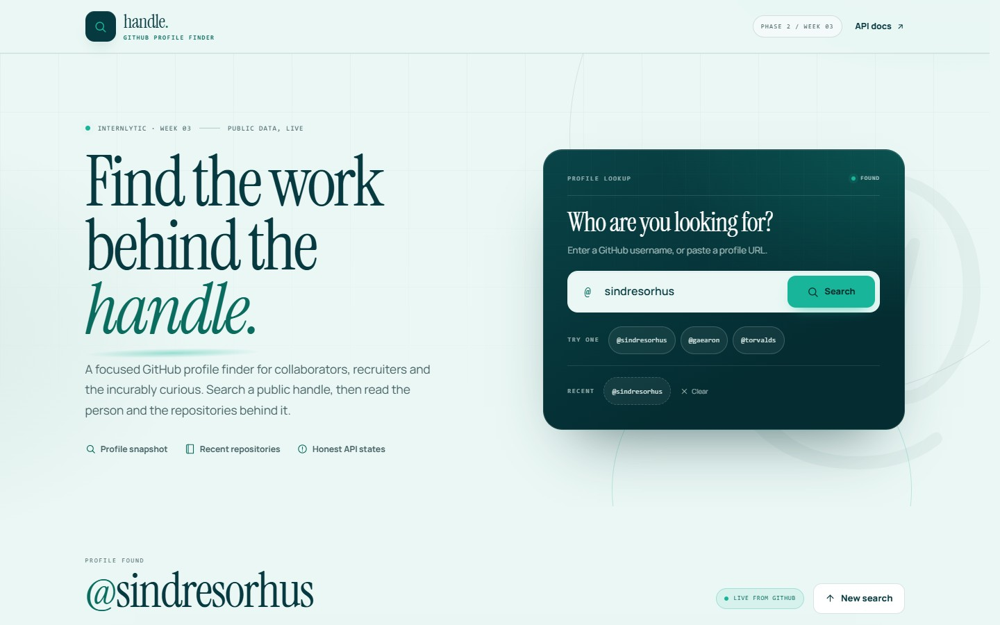
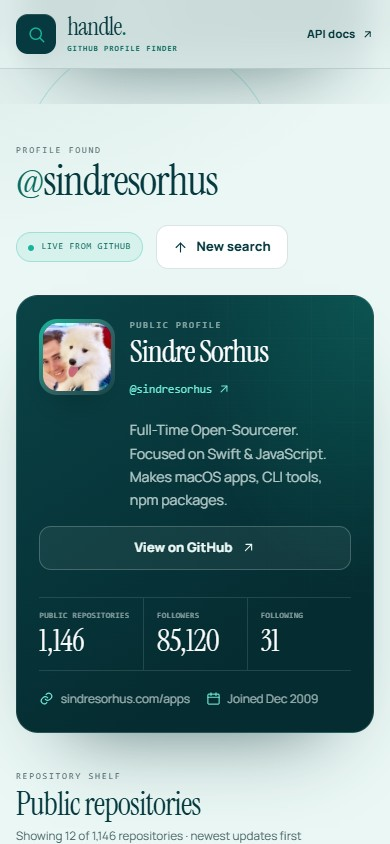
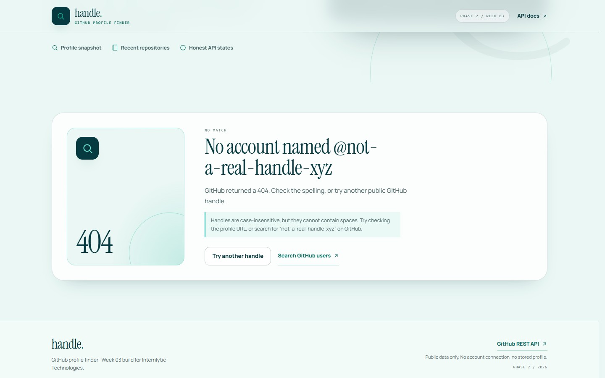

# handle. — GitHub Profile Finder

A focused GitHub profile finder built for **Internlytic Front-End Development — Phase 2, Week 03**. Enter a public handle (or paste a profile URL) and read the person, the numbers and the most recently updated repositories behind it.



## Features

- **Flexible search** — accepts `octocat`, `@octocat` or `https://github.com/octocat`; submits with the button or the Enter key.
- **Profile snapshot** — avatar, display name, `@handle`, bio, location, company, website and join date, with optional fields hidden when GitHub does not provide them.
- **Live numbers** — public repository count, followers and following.
- **Repository shelf** — name, description, primary language, star and fork counts, last update and a direct GitHub link. Archived and forked repositories are labelled.
- **Load more** — 12 repositories per request, sorted by newest update, with inline errors if a later page fails.
- **Honest states** — idle guide, skeleton loading, empty results, validation errors, `404` not found, `429`/rate limit, offline and generic HTTP failures. Rate-limit messages include the reset time when GitHub sends it.
- **Recent searches** — up to five handles kept in `localStorage`; nothing is sent to a server and no profile is cached.
- **Responsive and accessible** — one-column start at 320 px, keyboard-friendly form and focus management, live regions, skip link, visible focus rings and reduced-motion support.
- **No secrets** — the app talks to the public GitHub API directly from the browser and never contains a token.

| Mobile result | 404 state |
| --- | --- |
|  |  |

## API

Two public endpoints from the [GitHub REST API](https://docs.github.com/en/rest) are used:

| Purpose | Request |
| --- | --- |
| Profile | `GET https://api.github.com/users/:username` |
| Repositories | `GET https://api.github.com/users/:username/repos?sort=updated&direction=desc&per_page=12&page=:page` |

The profile and first repository page are fetched in parallel. Later pages are requested only when **Load more repositories** is pressed.

> **Rate limit:** unauthenticated GitHub REST requests are limited to **60 per hour per IP address**. When the limit is reached, the app shows a rate-limit state with the reset time and explains that waiting is the only reliable fix. No personal access token is placed in the front-end.

### Request safety

- Input is normalised and validated before any request; invalid handles never reach the API.
- Every search gets an `AbortController` and a request sequence number. Starting a new search aborts the previous request, and outdated responses are ignored, so older results can never replace a newer search.
- Network, HTTP, 404 and rate-limit failures are classified and mapped to clear messages.
- External links open in a new tab with `rel="noreferrer"`, and API-provided website URLs are restricted to `http(s)`.

## Tech stack

- React 19 + TypeScript
- Vite 8
- Oxlint
- Plain CSS with custom properties (no UI framework)

No runtime dependencies beyond React are required.

## Getting started

Requires Node.js 22+ and npm.

```bash
npm install
npm run dev      # local development server
npm run lint     # Oxlint
npm run build    # TypeScript check + production build
npm run preview  # preview the production build
```

The dev server prints its local URL (Vite defaults to `http://localhost:5173`).

## Project structure

```text
src/
  App.tsx                  Page composition, input state, focus management
  components/              Header, SearchForm, ProfileCard, RepoList,
                           RepoCard, Intro, LoadingState, ErrorState,
                           ResultsView, Footer, Icon
  hooks/
    useGithubSearch.ts     Search state machine, aborting, pagination, retry
    useRecentSearches.ts   localStorage-backed recent handles
  lib/
    github.ts              Typed API client, validation, error classification
    format.ts              Number/date formatting, safe URLs, language colours
  data/examples.ts         Example handles for the idle state
  styles/global.css        Design tokens, layout, components, responsive rules
docs/                      README screenshots
public/                    favicon and Open Graph cover
```

The search flow is a small state machine: `idle → loading → success | not-found | rate-limit | network | error`. Validation errors are kept separate so existing results stay visible while the user corrects the input.

## Accessibility notes

- The search field has a real label, hint text and `aria-invalid`/`aria-describedby` error wiring.
- Results and error states receive focus after a search; a polite live region announces loading and success counts.
- Error cards use `role="alert"`; the visual loading skeleton is hidden from assistive technology.
- All interactive targets are at least 44 px tall, focus is always visible, and motion is removed under `prefers-reduced-motion`.
- A skip link becomes the first focusable element on the page and moves focus to `<main>`.
- Automated [axe-core](https://github.com/dequelabs/axe-core) audits returned **0 violations** for the idle page, a successful profile, and the 404/500/429 states.

## Testing

Verified with Chrome via Playwright against the real API and mocked responses:

- valid searches (`sindresorhus`, `octocat`), invalid and empty input, Enter submission;
- 404, 429 with reset time, network failure and HTTP 500 states;
- slow response followed by a second search — final view stays on the newest query;
- loading skeleton, empty repository list, load more (12 → 24);
- viewports 320, 390, 768, 1024 and 1440 px with no horizontal overflow;
- keyboard tab order, skip link, focus after submit/error, reduced motion;
- zero console errors; `npm run lint` and `npm run build` pass.

## Deployment

A GitHub Pages workflow is included at `.github/workflows/deploy.yml`. It runs on pushes to `main` (or manually) and publishes `dist` through GitHub Actions.

1. Create a repository and push this folder to `main`.
2. In the repository, open **Settings → Pages** and set **Source** to **GitHub Actions**.
3. The included workflow builds and deploys the site.

`vite.config.ts` uses `base: './'`, so the build works from a project subpath such as `https://<user>.github.io/<repo>/`. After the first deployment, update the Open Graph/Twitter image URLs in `index.html` to the absolute deployed URL so social previews resolve reliably.

## Design

Brand palette used across the interface:

| Token | Value |
| --- | --- |
| Teal green | `#18B59A` |
| Deep blue-green | `#073A40` |
| White | `#FFFFFF` |
| Light tint | `#EAF7F4` |

Typography pairs Instrument Serif for editorial headlines with Manrope for UI text.

## Limitations

- Public GitHub data only; private profiles and private repositories are not available.
- Unauthenticated rate limiting is shared per IP address, so heavy use can be interrupted.
- Repository data is fetched 12 at a time and sorted by last update rather than relevance.
- Recent handles live in this browser's `localStorage` only.
- Fonts are loaded from Google Fonts; without a network connection the UI falls back to system fonts.

---

Built for Internlytic Technologies · Phase 2 / Week 03 · 2026.
